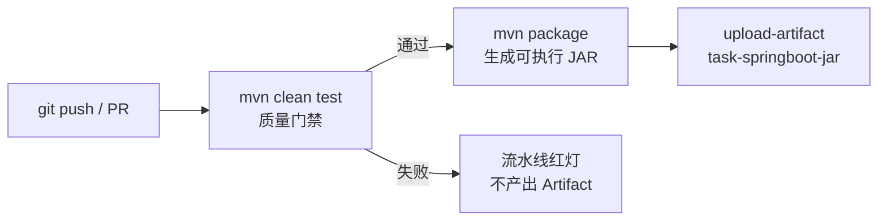

# TaskMaster · DevOps 实践与项目验收交付

> Java 高级编程实验（课程代号 33252070）第六阶段
> Spring Boot 3 + Thymeleaf + MyBatis-Plus + GitHub Actions CI/CD


[](.github/workflows/ci.yml)

TaskMaster 从「Servlet + JSP + JDBC」一路演进到「Spring Boot 3 + Thymeleaf + MyBatis-Plus + 可执行 JAR」。
本阶段补齐 **CI/CD 自动化流水线、OpenAPI 接口手册、PR 代码评审、Demo 演示方案**，
让「提交即验证、文档与代码同频、演示可复现」成为工程习惯，而不是答辩前的临时补救。

## 核心特性

- **任务管理**：新增 / 修改 / 删除 / 分页列表，标题模糊 + 状态筛选，查询条件翻页不丢；
- **双入口**：Thymeleaf 页面（表单 + 服务端校验回显）与 JSON API（统一响应体 + 错误码）；
- **安全边界**：Session 登录 + 拦截器；页面未登录 302 到 `/login`，API 未登录 401 JSON；
- **排序白名单**：`TaskSort` 枚举收敛排序列，`ORDER BY` 不接受外部字符串；
- **异步审计**：写操作触发 `@Async` 审计，`/api/audits` 可查，Demo 可观察线程名；
- **可交付**：`mvn clean test` 181 个用例门禁 → `mvn package` 可执行 JAR → GitHub Actions 归档；
- **零外部依赖演示**：test 环境用 H2 内存库，不需要安装 MySQL。

---

## 1. 架构简图

```mermaid
flowchart LR
    B["浏览器 / curl"] -->|HTTP| I["LoginInterceptor<br/>Session 鉴权"]
    I -->|页面请求| C1["TaskController<br/>Thymeleaf 模板"]
    I -->|/api/**| C2["TaskRestController<br/>JSON + 统一错误码"]
    C1 --> S["ITaskBuss / IUserBuss<br/>业务规则唯一实现"]
    C2 --> S
    S --> M["MyBatis-Plus BaseMapper<br/>条件构造器 + 分页插件"]
    M --> DB[("MySQL<br/>dev / prod")]
    M --> H2[("H2 内存库<br/>test / CI")]
    C2 -.->|@Async 异步审计| A["TaskAuditService<br/>task-audit-* 线程池"]
    A --> AS[("TaskAuditStore<br/>最近 200 条")]
    C2 -.->|契约| O["openapi.yaml<br/>/openapi.yaml"]
```

CI 流水线：



---

## 2. 技术栈

| 组件 | 版本 | 作用 |
| --- | --- | --- |
| JDK | 17 | 语言与运行环境 |
| Spring Boot | 3.2.12 | 自动配置、内嵌 Tomcat、可执行 JAR |
| Thymeleaf | 3.1.2（Boot 管理） | 服务端 HTML 模板，静态可预览 |
| MyBatis-Plus | 3.5.7 | `BaseMapper`、条件构造器、分页插件 |
| Spring Validation | Jakarta Validation 3.0 | `@NotBlank / @Size / @Min / @Max` |
| Spring `@Async` | Boot 管理 | 写操作异步审计 |
| MySQL | 8.x | dev / prod 数据库 |
| H2 | 2.2.224 | test 内存库（`MODE=MySQL`），测试/CI/Demo 不依赖物理 MySQL |
| JUnit 5 + Mockito + AssertJ | Boot 管理 | 单元测试、控制层切片测试、集成测试 |
| GitHub Actions | `ubuntu-latest` | Push/PR 触发 CI，归档 JAR 与测试报告 |

---

## 3. 目录结构

```text
task-servlet-demo
├── .github/workflows/ci.yml                   # 环节一：CI 流水线（test → package → artifact）
├── pom.xml                                    # jar 打包、Boot/MP/Thymeleaf/Validation 依赖
├── README.md                                  # 环境依赖、一键启动、架构与验收清单
├── docs
│   ├── api/API.md                             # 环节二：API 手册（入参/出参/错误码）
│   ├── code-review
│   │   ├── PR-001-rest-api.md                 # 环节三：REST 接口评审（注入 / N+1 / NPE）
│   │   └── PR-002-ci-pipeline.md              # 环节三：CI 流水线评审
│   └── demo/DEMO.md                           # 环节四：Demo 演示脚本与预置数据
├── scripts
│   ├── run-demo.ps1 / run-demo.sh             # 一键构建 + 启动（test 环境）
│   └── api-smoke.ps1                          # API 冒烟（登录 → CRUD → 401/404/注入 → 审计）
└── src
    ├── main
    │   ├── java/cn/edu/mju/band
    │   │   ├── TaskApplication.java           # 唯一启动类
    │   │   ├── api/                           # REST 控制器、统一响应体/错误码/异常处理
    │   │   ├── audit/                         # 异步审计服务与有界内存队列
    │   │   ├── buss/                          # 业务接口/实现 + 排序白名单 TaskSort
    │   │   ├── config/                        # 分页、MVC 拦截器、异步线程池
    │   │   ├── controller/                    # 页面控制器、全局异常、全局模型
    │   │   ├── entity/                        # Task / User（MP 注解 + Validation 注解）
    │   │   ├── exception/                     # ServiceException 体系
    │   │   ├── interceptor/LoginInterceptor.java
    │   │   ├── mapper/                        # TaskMapper / UserMapper（BaseMapper）
    │   │   └── web/SessionKeys.java
    │   └── resources
    │       ├── application.yml                # 公共配置 + 默认 dev
    │       ├── application-dev.yml            # MySQL、DEBUG、自动建表
    │       ├── application-test.yml           # H2、每页 3 条
    │       ├── application-prod.yml           # 环境变量、日志落盘、模板缓存
    │       ├── db/                            # H2 / MySQL 建表与种子数据
    │       ├── static/openapi.yaml            # 环节二：OpenAPI 3.0.3 规范
    │       ├── static/css/app.css
    │       └── templates/                     # Thymeleaf 模板（无 JSP）
    └── test/java/cn/edu/mju/band              # 11 个测试类，181 个用例
```

---

## 4. 快速开始

### 4.1 环境依赖

| 依赖 | 版本 | 是否必需 |
| --- | --- | --- |
| JDK | 17 | 必需（编译 + 运行） |
| Maven | 3.9+ | 构建时需要 |
| MySQL | 8.x | dev / prod 需要；test、CI、Demo 不需要 |
| 浏览器 | 现代浏览器 | 页面演示 |

### 4.2 一键启动（推荐答辩/验收使用）

```powershell
# Windows PowerShell：构建 + 以 test 环境（H2 内存库）启动到 18080 端口
powershell -ExecutionPolicy Bypass -File scripts/run-demo.ps1
```

```bash
# Linux / macOS / Git Bash
bash scripts/run-demo.sh
```

启动后访问 <http://localhost:18080>，账号 `admin / 123456`。
脚本会先执行 `mvn clean package`，产物为 `target/task-springboot.jar`。

### 4.3 手动构建与三种启动方式

```bash
mvn clean package
```

```bash
# ① dev：连接本机 MySQL（root/123456，库 taskmaster；不存在会自动创建并初始化表）
java -jar target/task-springboot.jar

# ② test：H2 内存库，无 MySQL 也能演示（推荐验收时使用）
java -jar target/task-springboot.jar --spring.profiles.active=test --server.port=18080

# ③ prod：数据库连接全部来自环境变量
export DB_URL='jdbc:mysql://127.0.0.1:3306/taskmaster?useUnicode=true&characterEncoding=utf8&serverTimezone=Asia/Shanghai&useSSL=false'
export DB_USERNAME='task_user'
export DB_PASSWORD='change-me'
java -jar target/task-springboot.jar --spring.profiles.active=prod
```

> Windows 下设置环境变量：PowerShell 用 `$env:DB_URL='...'`，CMD 用 `set DB_URL=...`。

### 4.4 默认账号

| 登录名 | 密码 | 说明 |
| --- | --- | --- |
| `admin` | `123456` | 演示账号，登录后可增删改查 |

> 账号表沿用 TaskMaster 既有结构（`t_user`：`id / username / password`），
> Java 侧用 `@TableField` 把 `username/password` 映射为 `loginName/loginPwd`，不修改原库字段。

> 教学示例使用明文口令，**生产环境必须改为 BCrypt/Argon2 哈希存储**，并修改默认密码。

---

## 5. REST API 与接口文档（环节二）

页面侧仍由 Thymeleaf 渲染；同一套业务规则额外暴露 JSON 接口，方便自动化验证、Demo 与接口手册。

| 方法 | 路径 | 说明 |
| --- | --- | --- |
| `GET` | `/api/tasks` | 分页查询（标题模糊、状态精确、白名单排序） |
| `GET` | `/api/tasks/{id}` | 查询单个任务，不存在返回 404 |
| `POST` | `/api/tasks` | 新增任务，成功 201 + `Location` |
| `PUT` | `/api/tasks/{id}` | 修改任务 |
| `DELETE` | `/api/tasks/{id}` | 删除任务 |
| `PATCH` | `/api/tasks/batch-status` | 批量改状态（一条 `UPDATE ... IN`） |
| `GET` | `/api/audits` | 最近异步审计事件 |

**认证**：与页面共用 Session Cookie。先 `POST /login`，再携带 `JSESSIONID` 调用。
未登录访问 `/api/**` 返回 `401` + `code=40100`，不会 302 到登录页。

```bash
curl -s -c cookie.txt -X POST http://localhost:18080/login \
     -d 'loginName=admin&loginPwd=123456'
curl -s -b cookie.txt 'http://localhost:18080/api/tasks?pageNum=1&pageSize=3&sort=title,asc'
```

**统一响应体**：

```json
{ "code": 0, "message": "成功", "data": {}, "timestamp": "2026-10-30T09:30:00+08:00" }
```

**错误码**：

| HTTP | `code` | 含义 |
| --- | --- | --- |
| 400 | `40001` | 参数校验失败、页码越界、非法排序字段、JSON 格式错误 |
| 401 | `40100` | 未登录或会话过期 |
| 404 | `40401` | 任务不存在 |
| 500 | `50001` | 数据库暂时不可用 |
| 500 | `50000` | 未预期的服务器内部错误 |

完整入参/出参/示例见 **[docs/api/API.md](docs/api/API.md)**；
OpenAPI 3.0.3 规范见 [`src/main/resources/static/openapi.yaml`](src/main/resources/static/openapi.yaml)，
应用启动后可直接访问 <http://localhost:18080/openapi.yaml>，也可导入 Apifox / Postman / Swagger Editor。

---

## 6. CI 自动化流水线（环节一）

工作流：[`.github/workflows/ci.yml`](.github/workflows/ci.yml)

| 项 | 配置 |
| --- | --- |
| 触发 | `push` / `pull_request` 到 `master` / `main`，支持手动 `workflow_dispatch` |
| Runner | `ubuntu-latest` |
| JDK | Temurin 17（`actions/setup-java@v4`，启用 Maven 缓存） |
| 质量门禁 | `mvn -B -ntp clean test`，任一测试失败即红灯，后续打包不执行 |
| 构建 | `mvn -B -ntp package -DskipTests`，生成 `target/task-springboot.jar` |
| 产物归档 | `actions/upload-artifact@v4`：`task-springboot-jar` + `surefire-reports` |
| 权限 | `contents: read`，最小权限 |
| 并发 | 同分支新提交取消旧流水线 |

本地等价验证（与 CI 相同命令）：

```bash
mvn -B clean test       # 181 个用例全部通过
mvn -B package -DskipTests
```

---

## 7. Code Review 与质量加固（环节三）

AI 生成的初稿并非「能跑就收」：两次 PR 评审共拦截 5 处问题，均有复现命令、修复提交与回归测试。

| PR | 审查对象 | 拦截问题 | 修复要点 |
| --- | --- | --- | --- |
| [PR-001](docs/code-review/PR-001-rest-api.md) | REST 接口 + 异步审计 | `ORDER BY` 字符串拼接（SQL 注入）、循环 `updateById`（N+1）、`findById` 空结果 NPE、新增接口无测试 | `TaskSort` 枚举白名单、单条 `UPDATE ... IN`、显式 404、补 20+ 用例 |
| [PR-002](docs/code-review/PR-002-ci-pipeline.md) | CI 流水线 | `mvn test` 未 clean 可能复用旧 class、`target/*.jar` 误传 `.original` | `mvn clean test` + 精确 JAR 路径 + 产物存在性校验 |

> 评审记录包含问题位置、复现步骤、风险等级、修复前后对比与复核测试，
> 对应报告要求的「人类工程师对质量把控的不可替代性」。

---

## 8. Demo 演示方案（环节四）

完整脚本见 **[docs/demo/DEMO.md](docs/demo/DEMO.md)**，包含：

1. **预置数据**：test 环境 7 条任务（待办/进行中/已完成）、`admin/123456`；
2. **正常交易链路**：登录 → 列表 → 搜索 → 新增 → 编辑 → 删除；
3. **极端边界报错**：空标题、状态 9、`pageSize=101`、不存在 id、未登录、`ORDER BY` 注入载荷；
4. **异步处理表现**：写操作立即返回，`task-audit-*` 线程异步落审计，`/api/audits` 可查；
5. **CI 演示**：push 后 Actions 运行、测试失败红灯、Artifact 下载。

一键冒烟（应用启动后）：

```powershell
powershell -ExecutionPolicy Bypass -File scripts/api-smoke.ps1
```

---

## 9. 测试

```bash
mvn test
```

当前共 **181 个用例**（含参数化展开），全部通过。

一条命令跑完「测试 → 打包 → 起服务 → 接口冒烟」的完整本地验收（答辩截图推荐用这个）：

```powershell
powershell -ExecutionPolicy Bypass -File scripts/verify-local.ps1
```

脚本依次执行：环境自检 → `mvn clean test`（质量门禁）→ 统计 surefire 用例 → `mvn package` 校验 JAR →
以 test 环境启动到 18080 → 调 `api-smoke.ps1` 跑 15 步接口冒烟 → 汇总；结束时自动关闭自己启动的进程。
执行细节与配套的截图清单见 [`docs/qa/TEST-GUIDE.md`](docs/qa/TEST-GUIDE.md)。

测试分层：

- `TaskBussTest` / `UserBussTest`：纯 Mockito 单元测试，不连数据库；覆盖排序白名单、批量更新单条 SQL、边界校验；
- `TaskRestControllerTest`：`@WebMvcTest` 切片，验证统一响应体、400/401/404 错误码、字段校验、注入拦截；
- `TaskControllerTest` / `LoginControllerTest` / `HomeControllerTest`：页面切片，验证参数绑定、`@Valid` 回显、登录拦截、重定向；
- `LoginInterceptorTest`：Session 放行/重定向/回跳记录，以及 `/api/**` 的 401 JSON；
- `SortSpecTest` / `TaskSortTest` / `TaskAuditStoreTest`：排序解析、注入载荷、有界队列；
- `TaskApplicationTests`：`@SpringBootTest + @ActiveProfiles("test")`，H2 上验证分页、事务、登录、REST 全链路与异步审计。

---

## 10. 数据库初始化

### 10.1 dev：自动初始化

`application-dev.yml` 打开了 `spring.sql.init.mode=always`，每次启动执行：

- `db/schema-mysql.sql`：`CREATE TABLE IF NOT EXISTS`（`t_task`、`t_user`）
- `db/data-mysql.sql`：幂等写入 `admin`；仅当 `t_task` 为空时补 3 条演示任务

因此换一台机器，只要 MySQL 可连接，应用第一次启动就能直接使用。

### 10.2 test：H2 自动初始化

`application-test.yml` 使用：

- `jdbc:h2:mem:taskdb;MODE=MySQL;DB_CLOSE_DELAY=-1`
- `db/schema-h2.sql` + `db/data-h2.sql`（7 条任务、1 个账号）

### 10.3 prod：由 DBA 手动执行

```bash
mysql -u root -p -e "CREATE DATABASE IF NOT EXISTS taskmaster DEFAULT CHARSET utf8mb4;"
mysql -u root -p taskmaster < src/main/resources/db/schema-mysql.sql
mysql -u root -p taskmaster < src/main/resources/db/data-mysql.sql   # 可选：演示数据
```

生产 profile 设置 `spring.sql.init.mode=never`，应用启动不会改表。

---

## 11. 跨机部署

以「开发机 A 构建，服务器 B 运行」为例：

1. **在 A 上构建**：`mvn clean package`，把 `target/task-springboot.jar` 与
   `src/main/resources/db/schema-mysql.sql`（可选 `data-mysql.sql`）拷到 B；
2. **在 B 上准备环境**：安装 JDK 17、MySQL 8，执行建表脚本；
3. **在 B 上启动**：

   ```bash
   export DB_URL='jdbc:mysql://127.0.0.1:3306/taskmaster?useUnicode=true&characterEncoding=utf8&serverTimezone=Asia/Shanghai&useSSL=false'
   export DB_USERNAME='task_user'
   export DB_PASSWORD='change-me'
   java -jar task-springboot.jar --spring.profiles.active=prod
   ```

4. **在 B 上验证**：

   ```bash
   curl -i http://127.0.0.1:8080/            # 302 -> /task -> /login
   curl -i http://127.0.0.1:8080/login       # 200 登录页
   curl -i http://127.0.0.1:8080/api/tasks   # 401 JSON（未登录）
   ```

5. **长期运行（可选）**：

   ```bash
   nohup java -jar task-springboot.jar --spring.profiles.active=prod > app.log 2>&1 &
   ```

> 生产建议：前面加 Nginx 反向代理并启用 HTTPS；`server.servlet.session.cookie.secure=true`；
> 用配置中心或密钥管理注入数据库密码。

---

## 12. 关键实现说明

### 12.1 可执行 JAR 与启动类

`pom.xml` 使用 `spring-boot-maven-plugin`，`mvn package` 生成带依赖的 fat jar：

```bash
mvn clean package
java -jar target/task-springboot.jar --spring.profiles.active=test
```

启动类只保留：

```java
@SpringBootApplication
@ConfigurationPropertiesScan("cn.edu.mju.band.config")
public class TaskApplication {
    public static void main(String[] args) {
        SpringApplication.run(TaskApplication.class, args);
    }
}
```

### 12.2 Thymeleaf 取代 JSP

`templates/fragments/layout.html` 抽出公共 `head / header / footer`，页面通过
`th:replace="~{fragments/layout :: header('list')}"` 复用；所有链接用 `@{...}` 生成，
自动带 context-path，不再需要 JSP 的 `${ctx}`。

模板是纯 HTML：`th:*` 只是额外属性，用浏览器打开文件仍能看到完整静态结构，
这就是「静态可预览」。

### 12.3 MyBatis-Plus 分页与条件查询

```java
Page<Task> page = new Page<>(pageNum, pageSize);

LambdaQueryWrapper<Task> wrapper = Wrappers.lambdaQuery(Task.class);
if (StringUtils.hasText(title)) {
    wrapper.like(Task::getTitle, title.trim());
}
if (status != null) {
    wrapper.eq(Task::getStatus, status);
}
wrapper.orderBy(true, ascending, sort.getColumn());

return taskMapper.selectPage(page, wrapper);
```

- `selectPage` 一次完成 **count + 当前页数据**，不再需要手写 `selectByPage` / `countByCondition`；
- 分页插件 `PaginationInnerInterceptor` 自动识别 MySQL/H2 方言；
- `maxLimit=100` 与业务层 `MAX_PAGE_SIZE` 双重限制，防止超大分页；
- 排序列来自 `TaskSort` 枚举（`SFunction` 引用），外部字符串不进入 SQL。

### 12.4 批量改状态：一条 SQL 取代 N+1

```java
UpdateWrapper<Task> wrapper = Wrappers.update();
wrapper.set("status", status).in("id", distinctIds);
return taskMapper.update(null, wrapper);
```

- 100 条任务：N+1 写法是 1 次查询 + 100 次 `UPDATE`，现在是 1 次 `UPDATE ... IN`；
- 编号先去重、过滤 null、限制最多 100 条，避免超长 IN 与长事务。

### 12.5 异步审计

`TaskAuditService#record` 标注 `@Async("taskAuditExecutor")`，写操作响应不等待审计完成；
`AsyncConfig` 提供独立线程池（核心 2 / 最大 4 / 队列 100 / `task-audit-*` 前缀 /
`CallerRunsPolicy` 兜底不丢事件）。`TaskAuditStore` 用有界队列保留最近 200 条，
`GET /api/audits` 可直接查看，Demo 时能直观看到异步线程名。

### 12.6 服务端校验与错误回显

- `Task` 字段加 `@NotBlank`、`@Size(max=100)`、`@NotNull`、`@Min/@Max`；
- 页面控制器使用 `@Valid @ModelAttribute("task") Task task, BindingResult bindingResult`；
- REST 控制器使用 `@Valid @RequestBody` + `MethodArgumentNotValidException`，返回字段级错误；
- Thymeleaf 用 `th:errors="*{title}"` 回显；
- HTML 的 `required` 只是客户端便利，`curl` 直接 POST 仍会被服务端拦截。

### 12.7 登录拦截与 API 401

`WebMvcConfig` 注册 `LoginInterceptor`：

```java
registry.addInterceptor(loginInterceptor())
        .addPathPatterns("/**")
        .excludePathPatterns("/", "/login", "/logout", "/error",
                             "/openapi.yaml", "/css/**", "/js/**", "/images/**", "/webjars/**");
```

- 未登录 GET：把原始 URI + 查询串写入 Session，重定向 `/login`；登录成功后回跳；
- 未登录 POST：只重定向，不保存表单，避免把密码拼进 URL；
- 未登录 `/api/**`：返回 401 JSON（`code=40100`），不重定向；
- 登录成功调用 `request.changeSessionId()` 防会话固定；退出 `session.invalidate()`；
- 回跳地址只接受以 `/` 开头且不以 `//` 开头的站内路径，防 open redirect。

### 12.8 统一异常处理

页面侧 `GlobalExceptionHandler` 把异常映射到 `error.html`；REST 侧 `TaskApiExceptionHandler`
（只作用于 `cn.edu.mju.band.api` 包，最高优先级）返回统一 JSON：

| 异常 | HTTP | 业务码 |
| --- | --- | --- |
| `MethodArgumentNotValidException` | 400 | `40001` + 字段错误集合 |
| `IllegalArgumentException` | 400 | `40001` |
| `TaskNotFoundException` | 404 | `40401` |
| `TaskServiceException` / `UserServiceException` | 500 | `50001` |
| 其他 `Exception` | 500 | `50000` |

---

## 13. 验收清单

| # | 操作 | 期望 |
| --- | --- | --- |
| 1 | `mvn clean package` | `BUILD SUCCESS`，生成 `target/task-springboot.jar` |
| 2 | `scripts/run-demo.ps1` | test 环境启动到 18080，日志出现 `profile is active: "test"` |
| 3 | 未登录访问 `/task` | 302 到 `/login` |
| 4 | `admin / 123456` 登录 | 302 回 `/task`，显示 7 条任务、每页 3 条、3 页 |
| 5 | 搜索「JaCoCo」+ 状态「已完成」 | 条件保留、结果正确、翻页不丢条件 |
| 6 | 新增标题为空 / 状态 9 | 回到表单，出现中文错误提示，不写库 |
| 7 | 新增合法任务 | 302 回列表，出现成功提示，列表可见 |
| 8 | 编辑任务、删除任务 | 修改生效；删除后列表少一条 |
| 9 | 退出登录后再访问 `/task` | 302 到 `/login` |
| 10 | `admin / wrong-password` 登录 | 提示「用户名或密码错误」 |
| 11 | `curl /api/tasks`（未登录） | 401 JSON，`code=40100` |
| 12 | 登录后 `curl /api/tasks` | 200 JSON，`code=0`，分页结构完整 |
| 13 | `sort=createTime;DROP TABLE t_task;--` | 400，`code=40001`，任务表仍可查询 |
| 14 | `scripts/api-smoke.ps1` | 全部 PASS |
| 15 | 新增/修改/删除后查 `/api/audits` | 出现 `task-audit-*` 线程写入的审计事件 |
| 16 | push 到 GitHub | Actions 运行：test → package → Artifact 可下载 |
| 17 | 直接打开 `templates/task.html` | 浏览器能显示完整静态结构（Thymeleaf 属性被忽略） |

---

## 14. 注意事项

1. **口令安全**：`admin/123456` 仅为课堂演示；上线前改为 BCrypt 哈希并修改默认密码。
2. **CSRF**：当前未引入 Spring Security，写操作没有 CSRF token；生产应加 Spring Security 或至少校验 Origin/Referer。
3. **数据库账号**：prod 使用最小权限账号（只授予 `SELECT/INSERT/UPDATE/DELETE`），不要用 root。
4. **日志**：prod 日志写入 `logs/task-springboot.log`，需要配置轮转（logback-spring.xml 或运维工具）。
5. **审计存储**：`TaskAuditStore` 是进程内队列，重启即清空；生产应改为 MQ + 持久化审计表。
6. **API 文档同步**：修改 DTO/接口时先改 `openapi.yaml` 与 `API.md`，再改代码，最后跑测试防止契约漂移。
7. **端口/上下文**：默认 `8080`、`/`；可用 `--server.port`、`--server.servlet.context-path` 覆盖。

---

## 15. 交付物索引

| 交付物 | 路径 |
| --- | --- |
| CI 流水线 | [`.github/workflows/ci.yml`](.github/workflows/ci.yml) |
| API 手册 | [`docs/api/API.md`](docs/api/API.md) |
| OpenAPI 规范 | [`src/main/resources/static/openapi.yaml`](src/main/resources/static/openapi.yaml) |
| 代码评审记录 | [`docs/code-review/PR-001-rest-api.md`](docs/code-review/PR-001-rest-api.md)、[`PR-002-ci-pipeline.md`](docs/code-review/PR-002-ci-pipeline.md) |
| Demo 演示脚本 | [`docs/demo/DEMO.md`](docs/demo/DEMO.md) |
| 一键启动 | [`scripts/run-demo.ps1`](scripts/run-demo.ps1)、[`scripts/run-demo.sh`](scripts/run-demo.sh) |
| API 冒烟 | [`scripts/api-smoke.ps1`](scripts/api-smoke.ps1) |
| 本地一键验收 | [`scripts/verify-local.ps1`](scripts/verify-local.ps1) |
| 测试与截图指南 | [`docs/qa/TEST-GUIDE.md`](docs/qa/TEST-GUIDE.md) |
